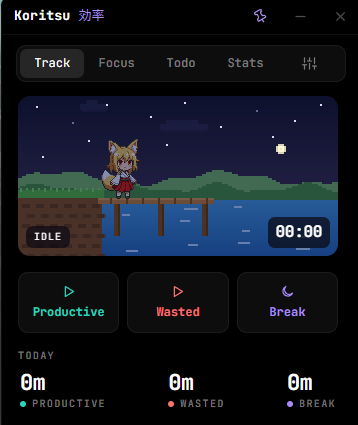

# Koritsu 効率

A tiny always-on-top widget that counts the time you waste and the time you spend well.

<p align="center"></p>

## Download

Grab the latest `Koritsu-…-windows-x64.zip` from [Releases](https://github.com/watsonjph/Koritsu/releases), unzip it and run `Koritsu.exe`. No installer.

- Needs the Microsoft WebView2 runtime (built into Windows 11 and up-to-date Windows 10).
- The exe isn't code-signed, so SmartScreen may say "unknown publisher": click **More info → Run anyway**.
- Put the exe where you'll keep it before turning on **Start with Windows**.

## Features

- **Track** productive, wasted and break time with one click and name what you're doing.
- **Companion**: a pixel-art character who fishes or reads while you work, doomscrolls in bed while you don't, and naps on breaks. The sky follows your clock, and sometimes it rains.
- **Stats** for day, week, month and year: charts, a breakdown by activity, and highlights that compare with the previous period.
- **Pomodoro** with adjustable lengths and rounds, auto-start, tick sounds and end-of-phase alerts.
- **Todo list** with timed reminders.
- **Make it yours**: themes and custom colours, character colours, switch sounds, English and 日本語.
- **Stays out of the way**: frameless, pin on top, snaps to screen corners, hides to the tray, exports to CSV.

## Keybinds

| Keys | Action |
|---|---|
| Ctrl+Alt+P / W / B | Start productive / wasted / break (works anywhere) |
| Ctrl+Alt+S | Stop tracking |
| Ctrl+Alt+F | Start / pause the Pomodoro |
| Ctrl+Alt+K | Show / hide Koritsu |
| Ctrl+1–5 | Switch tab |
| Esc | Close a dialog, or hide to the tray |

## Build from source

Needs a recent stable Rust toolchain.

```bash
cargo run --release
```

```bash
cargo test
```

Your data is a single JSON file at `%APPDATA%\koritsu\Koritsu\data\koritsu.json`; Settings shows the path and can export it as CSV.

## License

[GPL-2.0](LICENSE)
